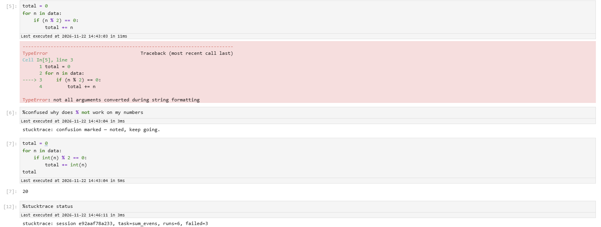
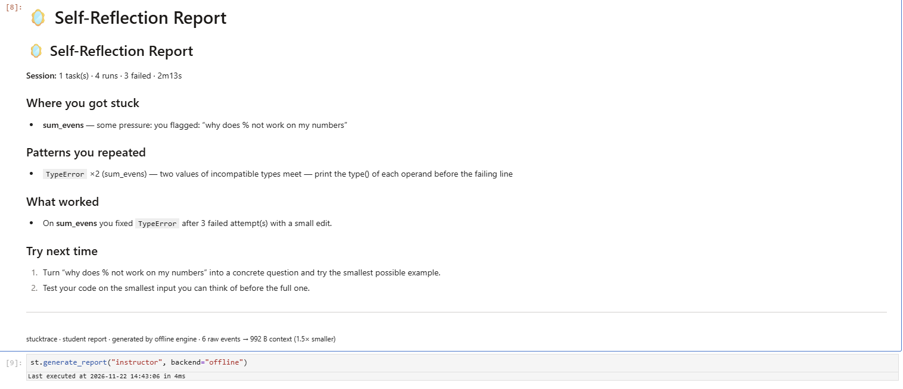

# stucktrace

**See where students get stuck, not just whether they passed.**

`stucktrace` is a zero-dependency Python library for Jupyter/JupyterHub that records *how* a student works through programming tasks (runs, errors, edits, pauses, visualizer use, explicit "I'm lost" markers), compresses that raw trajectory into a small structured context, and turns it into two reports:

- **Student Self-Reflection Report**: where you got stuck, which error patterns you repeated, what worked, what to try next. It never gives away the solution.
- **Instructor Diagnostic Report**: a per-task difficulty table, timestamped panic/stuck points, error clusters, error→fix transitions and suggested interventions.

It plugs into the **Moodle + OPT_Mentor + Hermes** stack: Moodle attempt metadata in and CSV/JSON out, OPT_Mentor trace import, and Hermes LLM reports. A built-in **offline report engine** takes over whenever Hermes is unreachable.

```python
%load_ext stucktrace            # every cell run is now recorded
%stucktrace task sum_evens
# ... student works, fails, retries ...
%confused why does % not work on my numbers
%stucktrace report student
```

---

## Motivation

A Moodle grade tells you the outcome of an attempt. Two students with the same 7/10 can have very different sessions:

- one solved everything steadily and lost points on an edge case;
- the other spent 6 minutes firing the same `TypeError` at the interpreter, went silent, rewrote the whole cell and got lucky.

Instructors can't watch 200 notebooks during a lab, and students rarely remember *how* they got stuck, only that they did. The process data already exists inside the kernel (every run, every traceback) but nobody keeps it. When someone does keep it, it's a raw log that is too long for a person to read and too noisy to send to an LLM.

`stucktrace` keeps the process data, compresses it, and explains it back to both sides:

| Who | Question | What stucktrace gives |
|---|---|---|
| Student | "Why did that take me so long?" | A no-spoiler reflection report: stuck points, repeated patterns, habits to change |
| Instructor | "Which task and which concept broke the class?" | Ranked hotspots, error clusters, panic timestamps, interventions, Moodle CSV |
| LLM (Hermes) | "What happened in this session?" | ~1–6 KB structured context instead of hundreds of raw events |

## Innovation

**1. Trajectory Compressor** (`compressor.py`). This is the core of the package, not just a logger:

- **Error-signature clustering.** Messages are normalized (identifiers, numbers, addresses stripped), so `name 'x' is not defined` and `name 'total' is not defined` count as *one* recurring misconception.
- **Six stuck/panic signals per task:**
  | Signal | Default rule |
  |---|---|
  | `rapid_fail_burst` | ≥3 failed runs, each ≤25 s after the previous one (trial-and-error mode) |
  | `repeated_error` | same error signature ≥3 times in a row |
  | `long_pause` | ≥120 s of silence right after a failure |
  | `rewrite` | ≥40 % of the code changed right after a failure (thrashing) |
  | `identical_rerun` | exactly the same code re-run right after a failure ("maybe it works this time") |
  | `confusion` | explicit `mark_confusion("I don't get the loop")` / `%confused` |
- **Panic score** in [0, 1]: a weighted combination of the signals (`1 - exp(-Σw/2)`) mapped to low / medium / high.
- **Key transitions.** Every failure→success step: which error was fixed, after how many failed attempts, how big the fixing edit was, and whether a visualizer step came first. This measures *whether visualization actually helped*.
- **Run-length digest.** The whole task in one line:
  `F:NameError | F:TypeError x3 | P:149s | ?"why does % not work" | V | S`
- **Measured compression.** On a simulated 210-run lab session, 95 KB of raw events become a 6 KB context (**15.6× smaller**). The demo session (14 events) compresses about 1.6×; the gain grows with session length.

**2. Fail-safe by design.** Every telemetry entry point swallows its own errors. Student exceptions are recorded and **re-raised untouched**. No network call can block or crash a notebook, and Hermes failures fall back to the offline engine with a visible warning.

**3. Spoiler guard.** LLMs like to "just show the fix", so multi-line code blocks are removed from student-facing reports automatically. The Hermes prompt also forbids solutions.

**4. Privacy knobs.** `store_code=False` keeps only hashes and lengths, never code. Raw OPT_Mentor traces are summarized into one event instead of being stored step by step.

## Architecture

```
            Jupyter cell hooks / @track / with track()      mark_confusion · log_viz
                               │                                     │
                               ▼                                     ▼
 ┌──────────────────────────────────────────────────────────────────────────┐
 │ tracker.py   Session: append-only Event log (run/confusion/viz/task)     │
 │              edit_ratio via difflib · autosave JSONL · ring buffer       │
 └───────────────────────────────┬──────────────────────────────────────────┘
                                 ▼
 ┌──────────────────────────────────────────────────────────────────────────┐
 │ compressor.py  error signatures → clusters → stuck signals → panic score │
 │                transitions · viz effect · run-length digest              │
 │                → CompressedTrajectory (.to_json / .to_markdown / .to_prompt)
 └───────────────┬───────────────────────────────┬──────────────────────────┘
                 ▼                               ▼
 ┌───────────────────────────────┐   ┌──────────────────────────────────────┐
 │ adapters.py                   │   │ reporter.py                          │
 │  MoodleAdapter  (in: attempt  │   │  generate_report(mode, backend, lang)│
 │    meta, out: CSV / JSON)     │──▶│   Hermes ──fail──▶ LocalReportGenerator
 │  OPTMentorAdapter (trace in)  │   │   spoiler_guard (student mode)       │
 │  HermesClient (LLM)           │   │   Report → Jupyter Markdown / .md    │
 │  LocalReportGenerator (EN/RU) │   └──────────────────────────────────────┘
 └───────────────────────────────┘
```

| Module | Responsibility |
|---|---|
| `events.py` | `Event` dataclass, the raw record format (JSONL-serializable) |
| `tracker.py` | `Session`, global API, IPython hooks and magics, `track` decorator/context manager |
| `compressor.py` | Trajectory Compressor (the innovation) |
| `adapters.py` | Moodle / OPT_Mentor / Hermes integrations and the offline report engine |
| `reporter.py` | Orchestration, fallback, spoiler guard, `Report` rendering |
| `cli.py`, `demo.py` | `stucktrace demo / report / compress / moodle` |

More detail: [`docs/architecture.md`](docs/architecture.md).

## Installation & Setup

```bash
pip install stucktrace                 # zero dependencies
pip install "stucktrace[jupyter]"      # + IPython (already present on any JupyterHub)
pip install "stucktrace[dev]"          # + pytest, build, twine
```

Requires Python ≥ 3.8 and uses only the standard library, so it can't conflict with what's already on a JupyterHub image.

**Hermes (optional).** Set environment variables, or pass a `HermesClient(...)`:

```bash
export HERMES_API_URL="https://<hermes-host>/v1/chat/completions"   # OpenAI-compatible endpoint
export HERMES_API_KEY="..."
export HERMES_MODEL="hermes"            # optional
export HERMES_TIMEOUT="12"              # optional, seconds per request
```

Network errors and 5xx answers are retried once; 4xx answers (e.g. a wrong key) fall back to the offline engine immediately.

If `HERMES_API_URL` is not set, reports are generated offline with no warning. If it is set but unreachable, you still get an offline report, marked with a warning.

## Quickstart

### JupyterHub

```python
import stucktrace as st
%load_ext stucktrace                  # or: st.start_session(student_id="s123", course="CS1302")
%stucktrace task loops                # name the current task
```

Then just work. Every cell run is recorded with its result, error type, duration and edit size. Cells that only drive stucktrace (magics, `st.*` calls) are ignored.

```python
%confused I don't understand why the loop stops early     # (avoid a trailing "?": IPython reads it as help)
st.log_viz(step=4, line=7, note="i == len(xs)")          # manual visualization step
%stucktrace status
%stucktrace report student            # renders Markdown in the notebook
%stucktrace report instructor --lang ru
%stucktrace save my_session.jsonl
%stucktrace reset                     # start a fresh session (save first!)
```




### Plain Python scripts

```python
import stucktrace as st
st.start_session(student_id="s42", jupyter=False)

@st.track("average")                 # each call = one attempt
def average(xs):
    return sum(xs) / len(xs)

try:
    with st.track("parse", code="int('4.5')"):   # context-manager form
        int("4.5")
except ValueError:
    st.mark_confusion("why can't int() read 4.5")

print(st.generate_report("instructor"))
st.get_session().save("session.jsonl")
```

### CLI

```bash
stucktrace demo                       # 45-second end-to-end demo (add --lang ru, --pause 2)
stucktrace report session.jsonl --mode instructor -o report.md
stucktrace compress session.jsonl --format prompt
stucktrace moodle session.jsonl --format csv
```

## Example Use Cases

1. **Lab session triage.** The TA collects `session.jsonl` files at the end of a lab and runs `stucktrace moodle` on each. Sorting by `panic_score` shows which students need a follow-up and which task broke the class.
2. **Exam post-mortem.** The instructor report marks persistent clusters (e.g. `TypeError` on `str % int` in 40 % of sessions), which points to a misconception to re-teach, not just a hard question.
3. **Student self-study.** A student ends a practice notebook with `%stucktrace report student` and gets habits to change ("change one thing at a time") without being given the answer.
4. **Does the visualizer help?** `viz_helped` and `viz_before` on transitions show whether OPT_Mentor tracing actually shortens time-to-fix.
5. **Moodle integration.** `MoodleAdapter.from_attempt(lti_params)` tags the session with the course/quiz/user IDs, and `export_attempt_json` / `export_csv` produce per-question rows to import.

```python
from stucktrace import MoodleAdapter, OPTMentorAdapter
MoodleAdapter.from_attempt({"courseid": 1302, "quizid": 7, "userid": "s1024", "attempt": 1},
                           question_map={"sum_evens": 1, "fizzbuzz": 2}).apply_to(st.get_session())
OPTMentorAdapter().import_trace(trace_json, task="sum_evens")   # Python-Tutor-style trace
```

## Example reports

Output of `stucktrace demo` (offline engine). Full EN/RU versions and the exact LLM context are in [`docs/report_examples.md`](docs/report_examples.md).

<details open><summary><b>Student Self-Reflection Report</b></summary>

```markdown
## 🪞 Self-Reflection Report
**Session:** 3 task(s) · 9 runs · 6 failed · 5m30s

### Where you got stuck
- **sum_evens** — high pressure: 4 failed runs in 16s; same TypeError 3× in a row;
  149s of silence after TypeError; you flagged: "why does % not work on my numbers?"
- **count_vowels** — low pressure: 44% of the code rewritten after IndexError

### Patterns you repeated
- `TypeError` ×3 (sum_evens) — two values of incompatible types meet — print the type()
  of each operand before the failing line

### What worked
- On **sum_evens** you fixed `TypeError` after 4 failed attempt(s) with a small edit.
- On **sum_evens** the visualizer helped: success came within a few runs after tracing.
- **fizzbuzz** worked on the first try.

### Try next time
1. When a run fails, stop for 30 seconds and read the *whole* traceback before re-running.
2. If the same error comes back, write down (or say out loud) what you *expect* that line to do.
3. Change one thing at a time — big rewrites after an error hide what actually fixed it.
```
</details>

<details><summary><b>Instructor Diagnostic Report</b></summary>

```markdown
## 🧭 Instructor Diagnostic Report
**Student:** s1024 · **Course:** CS1302 Intro to Programming · 5m30s

| Task | Runs | Solved | 1st success | Time | Panic | Top error |
|---|---|---|---|---|---|---|
| sum_evens | 5 | ✅ | 5 | 3m20s | high (0.81) | TypeError: not all arguments converted… |
| count_vowels | 3 | ✅ | 3 | 31s | low (0.22) | IndexError: string index out of range |
| fizzbuzz | 1 | ✅ | 1 | 0s | low (0.00) | — |

### Difficulty hotspots (ranked by panic score)
- **sum_evens** — high (0.81); visualizer used 1× (helped: yes)
  - `+00:05` rapid-fail burst: 4 failed runs in 16s
  - `+00:12` repeated error: same TypeError 3× in a row
  - `+00:21` long pause: 149s of silence after TypeError
  - `+02:50` confusion marker: "why does % not work on my numbers?"
  - digest: `F:NameError | F:TypeError x3 | P:149s | ?"why does % not work on m" | V | S`

### Suggested interventions
1. **sum_evens**: persistent `TypeError` — likely misconception; a 2-minute targeted explanation is worth it.
2. **sum_evens**: the student explicitly asked for help — follow up personally.
3. Visualization shortened time-to-fix on **sum_evens** — recommend it for similar exercises.
```
</details>

## Configuration

```python
from stucktrace import CompressorConfig, generate_report
cfg = CompressorConfig(panic_gap=25, panic_min_burst=3, repeat_streak=3, stall_gap=120, rewrite_ratio=0.4)
generate_report("instructor", config=cfg, backend="auto", lang="en")   # backend: auto | hermes | offline
st.start_session(store_code=False, autosave="live.jsonl")              # privacy / crash-safe log
```

## Development

```bash
python -m venv .venv && source .venv/bin/activate
pip install -e ".[dev]"
pytest -q                      # 54 tests, incl. real IPython shell + fake Hermes HTTP server
stucktrace demo
```

Team workflow: [`CONTRIBUTING.md`](CONTRIBUTING.md).

## Team

| Member | Role | Main contribution |
|---|---|---|
| Ulykbek (@ulykWyou) | Maintainer, release | Package scaffold, error hints, PyPI release |
| Alisher (@Alish082) | Tracker | `%stucktrace reset`, Jupyter hooks |
| Azat (@azatanafin) | Compressor | `identical_rerun` panic signal |
| Alisher (@hakiflow) | Integrations | Hermes timeout & retry logic |
| Insar (@KotaroIson) | Docs & demo | README, screenshots, changelog, contributing guide |

## Status & limitations (v0.1.1)

- The Hermes client assumes an OpenAI-compatible `chat/completions` API; adapt `HermesClient.complete` if your deployment differs.
- Moodle field names follow `mod_quiz` / LTI conventions but aren't tied to a specific Moodle web-service call yet.
- Panic thresholds are heuristics, chosen for introductory programming labs; tune them with `CompressorConfig`.
- Tracking is per kernel. Collecting sessions from many students is left to the deployment (shared folder, Moodle upload).

## License

MIT
